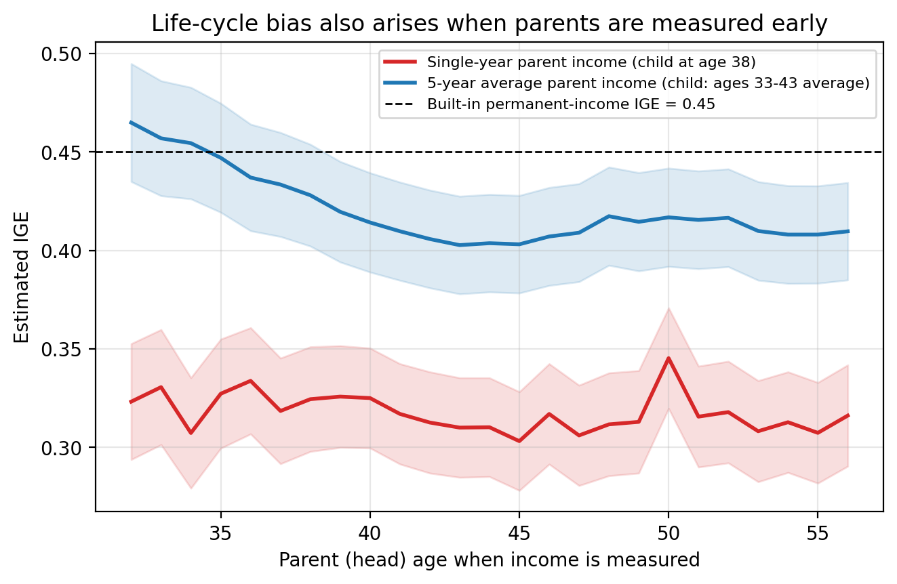
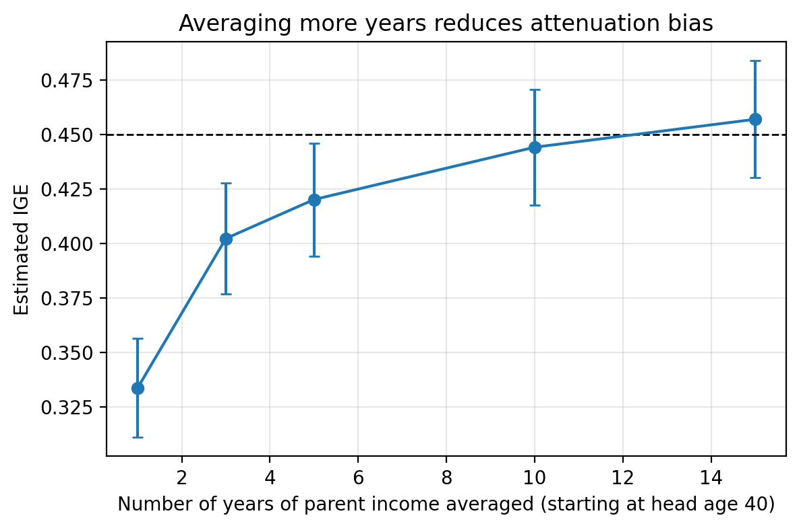

# Matching Parents and Children with SQL in Python: A Tutorial on the Intergenerational Elasticity and Life-Cycle Bias

## Why this tutorial?

How much of a child's economic success is "inherited" from their parents? The standard summary is the **intergenerational elasticity (IGE)**: the slope in a regression of log child income on log parent income. An IGE of 0.4 means that children whose parents earned 10% more tend to earn about 4% more themselves.

Estimating it takes two steps that are easy to underrate. First, you need to **match each child to their parents** in a longitudinal dataset where people are rows, years are rows, and families change over time. This is a data-wrangling problem, and SQL is the natural tool for it. Second, you need to decide **which income to use**. Income in a single year is a noisy and age-dependent snapshot of someone's long-run economic status, and that choice can change the estimate by a factor of two. I will show that with data.

This post is a tutorial: every SQL query below is in the repository and runs from Python, and you can follow along with basic Python and SQL knowledge.

**A note on the data.** The real workhorse for this question is the Panel Study of Income Dynamics (PSID), but it requires registration and cannot be redistributed. I therefore **simulate a PSID-style dataset** with the same structure (an individual ID, a family ID, and annual earnings) and a known data-generating process. This has an advantage: since I know the true permanent-income elasticity built into the simulation (0.45), I can check how far each estimate is from the truth. The numbers below illustrate the method, not the actual US IGE. The code works unchanged on real data with the same columns (see the README).

## The data

Two tables, as you would build from PSID files:

| Table | Columns | Meaning |
|---|---|---|
| `person` | `person_id`, `origin_family_id`, `role`, `birth_year`, `sex` | one row per individual; `role` is `head`, `spouse`, or `offspring` in the childhood family |
| `income` | `person_id`, `year`, `earnings` | one row per person-year |

There are 11,230 people, 5,566 of them children, and about 400,000 person-year income records covering 1965-2019. Incomes are missing in some waves for children, as in a real panel. The identifier logic is the key idea: `person_id` identifies *an individual*, and `origin_family_id` identifies *the family unit they grew up in*, so a child and their parents share the second identifier but not the first.

## Setup: SQL inside Python

SQLite is built into Python, so no server is needed. The pattern used throughout is: load the CSVs into a database, keep each query in a `.sql` file, and run it with `pandas.read_sql`.

```python
import sqlite3, pandas as pd

con = sqlite3.connect("data/processed/panel.db")
pd.read_csv("data/raw/persons.csv").to_sql("person", con, index=False)
pd.read_csv("data/raw/income.csv").to_sql("income", con, index=False)

def run_sql(con, name, **params):          # run a .sql file with named parameters
    return pd.read_sql(open(f"sql/{name}").read(), con, params=params)
```

Keeping SQL in separate files has two benefits: the queries stay readable, and named parameters (`:child_age`) let one query serve many specifications without string-pasting.

## Step 1: SELECT, FROM, WHERE

`SELECT` chooses columns, `FROM` chooses the table, and `WHERE` filters rows. For example, children born after 1965:

```sql
SELECT person_id, origin_family_id, birth_year
FROM   person
WHERE  role = 'offspring' AND birth_year > 1965;
```

Everything else in this tutorial builds on these three clauses.

## Step 2: JOIN to match children to parents

The match is a **self-join**: the same `person` table appears twice, once as the child (`c`) and once as the parent (`p`), connected by the family identifier. The `role` column picks the right generation.

```sql
CREATE VIEW parent_child AS
SELECT  c.person_id        AS child_id,
        p.person_id        AS parent_id,
        c.origin_family_id AS family_id,
        c.birth_year       AS child_birth,
        p.role             AS parent_role,
        p.birth_year       AS parent_birth
FROM    person AS c
JOIN    person AS p ON c.origin_family_id = p.origin_family_id
WHERE   c.role = 'offspring'
  AND   p.role IN ('head', 'spouse');
```

A plain `JOIN` (an inner join) returns a row only when the key matches on both sides. Each child therefore appears once per parent, so a child with two parents in the data gets two rows. We use that in the next step.

Inner joins silently drop non-matches, so it is good practice to **audit** what you lose. A `LEFT JOIN` keeps every child and shows `NULL` where no parent was found:

```sql
SELECT COUNT(DISTINCT c.person_id) AS children_without_parent_record
FROM   person AS c
LEFT JOIN person AS p
       ON  c.origin_family_id = p.origin_family_id
       AND p.role IN ('head', 'spouse')
WHERE  c.role = 'offspring' AND p.person_id IS NULL;
```

Result: of 5,566 children, **5,247 match to at least one parent and 319 (5.7%) do not**. In real PSID data the loss is usually larger and not random (for example, children who left home early are harder to link), which matters for how representative the final sample is.

## Step 3: GROUP BY and aggregation

We now need each child's **parental income**. Parents are on separate rows, and a household's income is the sum of the head's and spouse's earnings. This is exactly what `GROUP BY` and an aggregate function do: collapse many rows into one per group.

```sql
CREATE TABLE parent_family_income AS
SELECT  pc.child_id,
        i.year,
        SUM(i.earnings) AS family_earnings,
        MAX(CASE WHEN pc.parent_role = 'head' THEN i.year - pc.parent_birth END) AS head_age
FROM    parent_child AS pc
JOIN    income       AS i ON i.person_id = pc.parent_id
GROUP BY pc.child_id, i.year;
```

Reading it from the bottom: the second `JOIN` attaches each parent's earnings by `person_id`; `GROUP BY child_id, year` makes one output row per child-year; `SUM` adds the head's and spouse's earnings within each group; and `MAX(CASE ...)` is a trick for picking out the head's age (the `CASE` is `NULL` for the spouse, and `MAX` ignores `NULL`s). The aggregate functions you will use most are `SUM`, `AVG`, `COUNT`, `MIN`, and `MAX`.

Children's own income is a simple join of `person` and `income` on `person_id`, with age computed as `year - birth_year` (see `sql/03_income_tables.sql`).

### One year versus several years

Here is the key design choice. To use a **single year**, we pick one year of child income and one year of parent income:

```sql
SELECT c.child_id, c.earnings AS child_income, pf.family_earnings AS parent_income
FROM   child_income AS c
JOIN   parent_family_income AS pf ON pf.child_id = c.child_id
WHERE  c.age = :child_age AND pf.head_age = :parent_age
  AND  c.earnings > 0 AND pf.family_earnings > 0;
```

To use **multi-year averages**, we `GROUP BY` the child again, this time averaging over an age window. `HAVING` filters *groups* (just as `WHERE` filters rows), so we can require a minimum number of observed years:

```sql
WITH c AS (
    SELECT child_id, AVG(earnings) AS child_income
    FROM   child_income
    WHERE  age BETWEEN :c_lo AND :c_hi
    GROUP BY child_id
    HAVING COUNT(*) >= :min_c
),
p AS (
    SELECT child_id, AVG(family_earnings) AS parent_income
    FROM   parent_family_income
    WHERE  head_age BETWEEN :p_lo AND :p_hi
    GROUP BY child_id
    HAVING COUNT(*) >= :min_p
)
SELECT c.child_id, c.child_income, p.parent_income
FROM   c JOIN p ON p.child_id = c.child_id
WHERE  c.child_income > 0 AND p.parent_income > 0;
```

Both versions return the same three columns, so the estimation code does not care which one produced the data. Note that I average income in levels and then take logs, so a year with zero earnings still contributes to the average; averaging logs would require dropping those years.

## Step 4: Estimating the IGE

The estimation is a regression of `log(child_income)` on `log(parent_income)`; the slope is the IGE. I wrote a small OLS function with heteroskedasticity-robust (HC1) standard errors, equivalent to `statsmodels`' `OLS(...).fit(cov_type="HC1")`.

```python
def estimate_ige(df):
    y = np.log(df["child_income"]); x = np.log(df["parent_income"])
    X = np.column_stack([np.ones(len(x)), x])
    ...  # OLS with HC1 robust standard errors; returns slope, se, n
```

### Headline result

| Specification | IGE | 95% CI | N |
|---|---|---|---|
| Single year: child age 28, parent age 40 | 0.237 | [0.217, 0.257] | 4,988 |
| Single year: child age 35, parent age 45 | 0.288 | [0.265, 0.311] | 4,989 |
| Single year: child age 40, parent age 50 | 0.354 | [0.327, 0.381] | 4,983 |
| 5-year averages: child 33-37, parent 43-47 | 0.372 | [0.348, 0.396] | 5,112 |
| Long-run: child 30-45, parent 40-55 | 0.433 | [0.408, 0.458] | 5,243 |
| *Benchmark: permanent-income slope in the simulation* | *0.454* | | |

The same data and the same method give estimates between **0.24 and 0.43**, depending only on which income measure we use. A researcher who picked the first row would conclude that America (here, the simulated country) is far more mobile than a researcher who picked the last. The last row is also the only one that comes close to the benchmark.

## Life-cycle bias

Why do single-year estimates depend so strongly on *when* we measure income? Because **annual income at a given age is not a clean proxy for lifetime income**. Two forces are at work.

1. **Life-cycle (age) bias.** People with high lifetime earnings tend to have *steeper* age-earnings profiles. A future lawyer and a future cashier may earn similar amounts at 23, and diverge by 40. At young ages, current income therefore understates the gap in permanent income. Haider and Solon (2006) call this the heterogeneous growth problem. In the simulation, the weight of permanent income in current income rises from 0.5 at age 22 to 1.0 at age 40.
2. **Attenuation bias.** Annual income also contains transitory shocks (bonuses, job loss, a bad year). Noise in the *explanatory* variable shrinks the OLS slope toward zero (classical measurement error). Noise in the dependent variable does not bias the slope, but it makes the estimate less precise.

Under a simplified version of the simulation, the OLS slope behaves like this:

IGE estimate ≈ true IGE × (λ_child × λ_parent × σ²_θ) / (λ²_parent × σ²_θ + σ²_u)

where λ is how strongly permanent income shows up in income at the age we measure, σ²_θ is the variance of permanent income, and σ²_u is the variance of transitory shocks. Small child λ (measuring children young) shrinks the estimate; large σ²_u (using a single year) shrinks it as well.

### Evidence: the child's age at measurement

Figure 1 holds the parent side fixed and slides the child's measurement age from 23 to 43.


*Figure 1. IGE estimated at different ages of the child. Shaded bands are 95% confidence intervals. The dashed line is the permanent-income elasticity built into the simulation.*

The red line (single year) climbs steadily from **0.19 at age 23 to 0.33 at age 41**. The estimate nearly doubles just because children are older when we look at them. This is life-cycle bias in action: researchers who use data on children in their 20s, as many early studies did, will understate persistence. The blue line, which averages five years of child income and ten-plus years of parent income, shows the same upward drift (0.26 at 23 to 0.47 at 41) but sits far above the red line and reaches the true value around ages 38 to 41, which is when λ reaches 1 in this simulation.

Two lessons follow. First, the age gradient is the signature of life-cycle bias: it should not exist if single-year income were a clean measure of long-run status. Second, even at the oldest ages, the red line stays well below 0.45. Age bias has mostly disappeared by then, so the remaining gap is the attenuation from using a single noisy year.

### Evidence: the parent's age at measurement

Figure 2 does the opposite: it fixes the child's income (a 10-year average, ages 33-43) and slides the age at which parent income is measured.



*Figure 2. IGE estimated at different ages of the parent (head).*

The parent side is less dramatic in this simulation. The single-year estimates are flat at about 0.31 to 0.35 across ages, because attenuation from the noisy single year dominates everything else. The five-year-average line is much higher and shows a mild pattern consistent with the theory: it is slightly above the benchmark when parents are measured young, at 32 (0.46), and settles near 0.41 after age 40. I would not push this result too far: it comes from one simulated dataset, and the child-age effect is much larger.

## Why averaging over several years helps

Averaging solves the attenuation problem directly. If transitory shocks are only partly correlated from year to year, they partly cancel when we average, while permanent income does not change. The noise-to-signal ratio in the regressor falls, and the slope moves back toward the truth. Averaging over a *range of ages* also reduces life-cycle bias because it mixes years when the profile is steep with years when it is flat.

Figure 3 isolates the attenuation channel: it averages parent income over more and more years starting at age 40, with the child's income fixed as a nine-year average.



*Figure 3. IGE as the number of averaged parent-income years increases.*

| Years of parent income averaged | IGE |
|---|---|
| 1 | 0.334 |
| 3 | 0.402 |
| 5 | 0.420 |
| 10 | 0.444 |
| 15 | 0.457 |

Going from one year to three raises the estimate by 0.07, and each additional year helps by less. This diminishing return is typical: most of the transitory noise in a series with moderate persistence is removed by the first few years of averaging. By 15 years the estimate is within the noise of the benchmark. The practical rule from this and from the literature (Solon, 1992; Mazumder, 2005) is to average income over as many years as the data permit, and to measure both generations in mid-career, when income is closest to a person's long-run level.

## Pitfalls and limitations

- **Simulated data.** The patterns here follow from the data-generating process I chose, so the magnitudes (0.19, 0.33, and so on) should not be read as estimates of actual IGEs. The *direction* of the biases, however, matches what the literature documents for real data.
- **Match selection.** 5.7% of children had no parent record. In real data, who is matched is rarely random.
- **Constrained samples.** Requiring many years of data for both generations shrinks and reshapes the sample (here it is mild, with N between roughly 5,000 and 5,250 across specifications).
- **Zeros and logs.** Dropping non-positive incomes is common but has consequences, and averaging in levels versus logs gives different answers.
- **Family income versus individual earnings.** I used the sum of both parents' earnings for parents and individual earnings for children; other choices (household income, sons only, father-only) give different elasticities.
- **Standard errors.** Siblings share parents, so errors are probably correlated within families. Clustering by `origin_family_id` would be the next refinement.

## Takeaway

SQL does two jobs in this workflow. `JOIN` builds the link between generations from person and family identifiers, with a `LEFT JOIN` audit to show what the match loses. `GROUP BY` with `SUM`, `AVG`, and `HAVING` turns a person-year panel into one analysis row per child, whether we want a single year or an average over many. Both steps are explicit, reproducible, and easy to check, which is much harder when the match is buried in a long script of data-frame edits.

The substantive lesson is that the IGE is only as good as the income measure behind it. With the same sample and the same regression, single-year estimates ranged from 0.19 to 0.33 depending on the age at which children were observed (Figure 1), and from 0.24 to 0.35 across the three single-year rows in the headline table. A long-run average gave 0.43, close to the 0.45 truth. Two distinct forces explain the gap: life-cycle bias, because lifetime earnings differences only show up in annual income later in life, and attenuation bias, because a single year is noisy. The first is fixed by measuring people at the right stage of life, and the second by averaging over several years. A researcher who ignores either will report a country as more mobile than it really is.

For readers doing their own work, the checklist is short: match on identifiers and audit the loss; build income measures in SQL with explicit age windows; average over as many years as possible; measure both generations in mid-career; and always plot the estimate against age at measurement, because a visible slope is a warning that the single-year number is unreliable.

## Replication

All code is in the repository; see `README.md`. Open `ige-sql.Rproj` in RStudio and run `source("code/run_all.R")` to regenerate every table and figure in this post.

## References

- Haider, S., and Solon, G. (2006). Life-Cycle Variation in the Association between Current and Lifetime Earnings. *American Economic Review*, 96(4), 1308-1320.
- Mazumder, B. (2005). Fortunate Sons: New Estimates of Intergenerational Mobility in the United States Using Social Security Earnings Data. *Review of Economics and Statistics*, 87(2), 235-255.
- Solon, G. (1992). Intergenerational Income Mobility in the United States. *American Economic Review*, 82(3), 393-408.
- Panel Study of Income Dynamics, Institute for Social Research, University of Michigan (the real dataset this simulation imitates).
